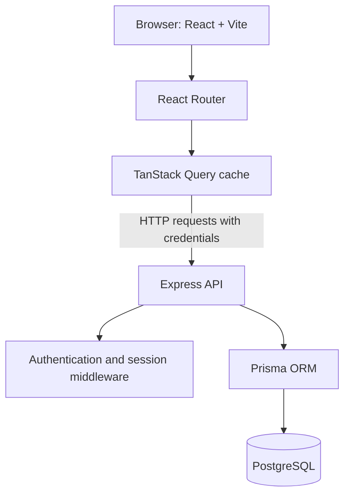

# Hibi architecture

This document describes the current high-level architecture. It is intentionally not a substitute for the source code: route names, schemas, and implementation details should be checked against the current repository when they change.

## System overview

The frontend and backend are separate applications. The frontend calls the API through a configurable base URL. The backend uses Prisma to read and write PostgreSQL data.

## Frontend

You can read about frontend architecture in [FRONTEND GUIDE](FRONTEND_GUIDE.md).

The client uses React and TypeScript, with:

- **React Router** for page routing and protected routes.
- **TanStack Query** for server-state fetching, caching, mutations, and invalidation.
- **Tailwind CSS** for styling.
- **lucide-react** for icons.
- A shared API client that includes browser credentials and centralizes handling of API errors and unauthorized responses.

The shared QueryClient currently uses a 30-second query `staleTime`, one retry by default, and disables refetch-on-window-focus by default. Authentication's current-user query has its own options.

### Authentication flow

1. The login or registration page sends credentials to the API.
2. The server validates the request and checks or creates the user.
3. The server creates a session and sends a session cookie.
4. The frontend requests the current user to determine whether protected pages can render.
5. If a protected API request returns `401`, the API client clears cached query data and redirects to login.

The cookie is `HttpOnly`, so client-side JavaScript cannot read the session token.

### Draft persistence

The journal's new-entry draft and edits to existing entries are stored in browser `localStorage`. This allows draft recovery after a refresh or a session-expiry redirect on the same browser and origin.

This is **browser-local persistence**, not server-side draft synchronization. It does not guarantee recovery if browser storage is cleared, unavailable, or the user switches devices.

## Backend

You can read more about backend in the backend section in [CODEBASE_GUIDE](CODEBASE_GUIDE.md).

The backend uses Express 5 with TypeScript and exposes API routes for authentication, journals, and habits.

Responsibilities include:

- Validate incoming data.
- Hash passwords before storing them.
- Create, validate, and revoke sessions.
- Enforce authentication on protected routes.
- Scope journal entries, habits, and completions to the authenticated user.
- Return API responses and errors to the frontend.

The authentication routes currently include:

- `POST /api/auth/register`
- `POST /api/auth/login`
- `POST /api/auth/logout`
- `GET /api/auth/me`

The application also exposes `GET /api/health`. Confirm the mounted route configuration in the current app entrypoint if the file layout changes.

## Sessions

The server generates a cryptographically random session token. It stores a SHA-256 hash of that token in the database and sends the raw token only in the session cookie. On authenticated requests, middleware hashes the cookie token and looks up the corresponding session, including its expiry.

The session lifetime is currently seven days. Expired sessions are rejected and removed. Logout deletes the session and clears the cookie.

## Data model overview

Prisma and PostgreSQL persist application data. At a conceptual level, the current model includes:

- **User** — account identity and password hash.
- **Session** — hashed session token, user association, and expiry.
- **Journal entry** — a user's journal content and associated metadata.
- **Habit** — a habit owned by a user.
- **Habit completion** — a completion record associated with a habit and date.

Use the Prisma schema as the source of truth for exact fields, indexes, constraints, and relation behavior. Do not infer the complete schema from this overview.

## Data isolation

Journal and habit controllers use the authenticated user's ID when querying or mutating user-owned data. Integration tests cover cross-user isolation. This authorization boundary must remain enforced on the server; hiding another user's data in the UI is not sufficient.

## Future architecture: Hibi Explore

The following is a product direction, not current functionality:

1. Represent journal entries with embeddings for semantic similarity.
2. Retrieve potentially related entries.
3. Let the user accept, reject, or manually add relationships.
4. Allow users to collect selected entries into a book or collection.
5. Evaluate whether feedback improves ranking and relevance.

Candidate technologies previously considered include a pretrained embedding model and PostgreSQL `pgvector`. These choices have not been finalized. Any AI integration should make data processing clear to users and preserve their control over their entries.
